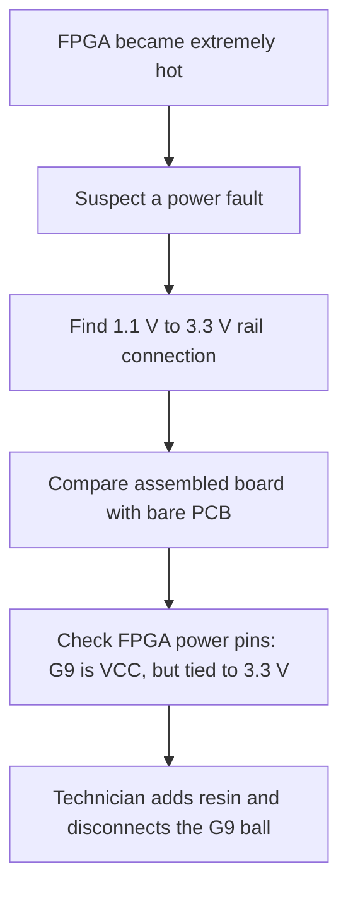

# How I Found The FPGA Power Short

Documented on October 24, 2026. This records the Rev 1 bring-up investigation;
the date is the documentation update, not a claimed date of the original fault.

## The First Clue Was Heat

During bring-up, the Lattice ECP5 FPGA became extremely hot and appeared to
start burning. That made me suspect a power problem before a camera or RTL
problem. My initial possibilities were a supply shorted to ground or two
different voltage rails accidentally connected together. Heat was the clue
that prompted the investigation; it did not identify the bad pin by itself.

I checked the power rails and found a connection between the nominal 3.3 V
rail and the FPGA's 1.1 V core rail. I remember the higher rail being around
3.38 V and the core rail reading roughly 1.8 V during the fault. Those are
approximate recollections, not saved instrument readings. The suspected core
overvoltage was consistent with the overheating, but I did not establish a
precise internal damage mechanism.

For context, the [ECP5 family datasheet](https://www.latticesemi.com/view_document?document_id=50461)
specifies 1.045-1.155 V as the recommended ECP5 VCC range and 1.32 V as the
absolute maximum (Tables 3.1 and 3.2). If the recalled 1.8 V reading was on
VCC, it exceeded both limits. This supports the overvoltage diagnosis without
establishing the extent of damage.

## Narrowing It Down To G9

The assembled boards showed the rail-to-rail short, while the bare,
unassembled PCBs did not show the same short. That focused my attention on
the FPGA and its BGA power connections. It did not prove a solder bridge or
rule out a design error: a wrong connection to an FPGA power ball can become
a rail-to-rail path only when the package is fitted.

I reviewed the FPGA pins and their assigned nets. That led me to **ball G9**:
it had accidentally been connected to **3.3 V**, even though it is a **VCC
core-supply ball** that belongs on **1.1 V** for this device. The checked part
is `LFE5U-25F-6BG256C`; the `CABGA256` column of the
[Lattice pinout kept in this repo](../PCB/Datasheets/FPGA-SC-02033-2-0-ECP5U-25-Pinout.csv)
lists G9 as VCC. Using the correct package column matters because G9 has
different assignments in other packages.



## What The Technician Did

I took the board to a repair technician. The technician added resin and
disconnected the G9 ball. This is the physical repair I can describe; I am
not claiming that G9 was rerouted to 1.1 V, that the FPGA was replaced, or
that a particular reballing procedure was used.

The repair removed the reported short and allowed bring-up to continue.
The project subsequently demonstrated camera capture, FPGA pixel conversion
and detection overlays, and preview through the ESP32-S3. The existing
[SaturnAI camera demonstration](https://youtu.be/1sOSSh_YdGI) documents that
working camera path. It is not a fresh electrical qualification of the repair.

Disconnecting a required supply ball was a prototype repair. A new board
should connect G9 correctly to the core rail and satisfy the device's power
requirements. Successful preview alone does not establish long-term
reliability after the overheating event.

## What Is Fixed In The Files, And What Remains

The October 24 review compared the updated
[EasyEDA project](../PCB/Ai-Camera.eprj), its
[schematic PDF](../PCB/SCH_Schematic1_2026-10-24.pdf), and the previous Git
version of the project.

| Item | Verified status |
| --- | --- |
| Assembled prototype | Short reported repaired by disconnecting G9 with technician assistance. |
| Updated FPGA schematic | G9 connects to `+1V1`; the old branch to `+3V3` has been removed. |
| Schematic PDF | Page 2, `FPGA`, shows G9 connected to `+1V1`. |
| PCB layout inside the EasyEDA project | Still contains the G9 pad assignment to `+3V3`; the PCB document is unchanged from the previous committed version. |
| Older Altium exports and backups | Historical references; they do not represent a newly corrected manufacturing release. |
| Post-repair measurements | Exact rail voltages, current draw, temperature, and test duration have not been recorded in this update. |

The remaining PCB assignment was read from the decoded `pcb1` document in
`Ai-Camera.eprj`:

```text
["PAD_NET","e1","G9","+3V3","e650"]
```

**The schematic correction has not yet been propagated into the PCB layout.**
Before fabrication, update the PCB from the corrected schematic, remove the
old G9 connection, route G9 to `+1V1`, and repour/check the affected copper.
Changing a pad's net label alone is not a routing fix. Run ERC/DRC, compare
all FPGA power pins with the package pinout, and regenerate the manufacturing
outputs from that reviewed layout. See the [Rev 1 errata](../PCB/REV1_ERRATA.md)
for the other outstanding board issues.

## What I Learned

The useful sequence was observation, rail checks, assembled-versus-bare-board
comparison, and then a package-pin/net review. I needed to check both
rail-to-ground and rail-to-rail paths. I also needed to keep three separate
milestones visible: repairing the prototype, correcting the schematic, and
correcting the routed board.

For the next bring-up, I will record resistance readings before power-up and
rail voltages, supply current, temperature, and run duration afterward. The
[bring-up checklist](BRINGUP_PLAN.md) keeps those checks ahead of camera and
firmware debugging.
