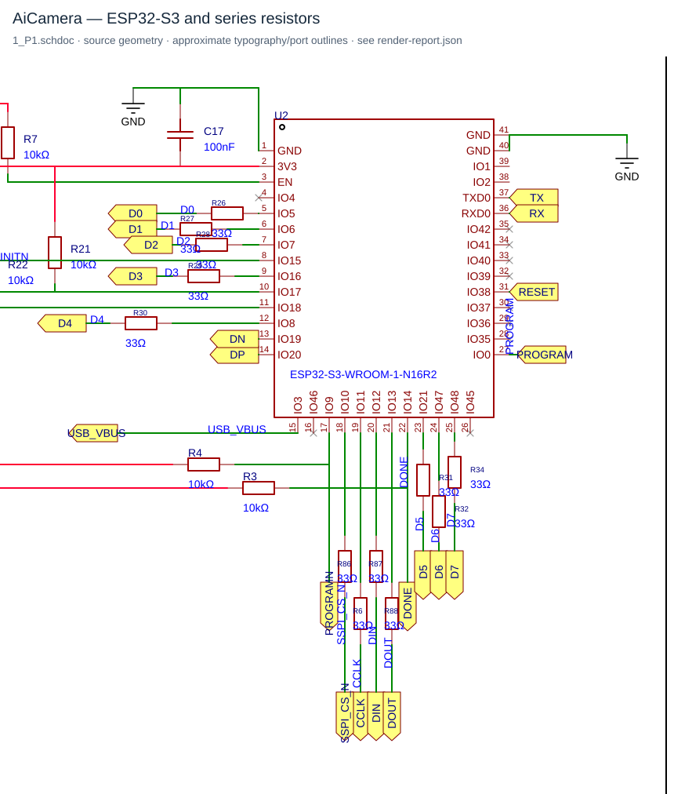
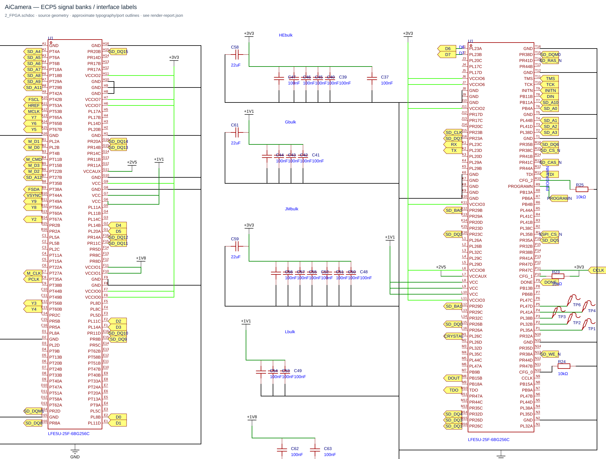

# SaturnAI Camera — a custom FPGA-to-ESP32 video link

**Kunshpreet Baweja · PCB design, FPGA logic, and embedded firmware**

> Prepared for WindBorne's Electrical Engineer Intern PCB challenge. Rev 1.0 is a bring-up board with documented errata.

I designed and brought up SaturnAI, a six-layer camera board combining a Lattice ECP5 FPGA and an ESP32-S3. The working system captures camera data, converts YUYV to RGB565 in the FPGA, and sends a live 160 × 120 preview to a computer through the ESP32.

## The detail I would highlight

The working FPGA-to-ESP32 link reuses the board's routed GPIO connections as **six data lanes, a strobe, and a frame gate**. I pack each 16-bit RGB565 pixel into three six-bit transfers. That provides 18 bit positions, leaving two spare bits for a small XOR check that the ESP32 verifies when it reconstructs the pixel.

| Transfer | Six data bits |
| --- | --- |
| 1 | Pixel bits `[15:10]` |
| 2 | Pixel bits `[9:4]` |
| 3 | Two check bits, followed by pixel bits `[3:0]` |

The check is `pixel[15:14] XOR pixel[9:8] XOR pixel[1:0]`. It uses otherwise spare positions without adding another data line or a fourth transfer. It is a lightweight check over selected bits: some corruptions will pass it, and it does not correct errors.

This is the hardware/firmware detail I like: the FPGA handles pixel timing and processing, while the ESP32 reconstructs the stream and bridges it to the host. The cost is three transfers per pixel. End-to-end preview ran at roughly 2 fps during bring-up, primarily limited by ESP32 software GPIO capture and USB/serial transfer.

## Following the link on the schematic

These review figures are rendered from the repository's Altium ASCII schematics at commit `b4b62d2`. Wire, pin, and component geometry comes from the source; typography and port outlines are approximate, and redundant identical labels are suppressed for readability. The [rendering report](visuals/render-report.json) records these presentation changes. The original [ESP32 sheet](https://github.com/regular030/AiCamera/blob/b4b62d2e0d55e3bb11aedd477f4760736fb4223b/PCB/altium/Altium_Ai-Camera_2026-02-28/Ai-Camera/Board1/Schematic1/1_P1.schdoc) and [FPGA sheet](https://github.com/regular030/AiCamera/blob/b4b62d2e0d55e3bb11aedd477f4760736fb4223b/PCB/altium/Altium_Ai-Camera_2026-02-28/Ai-Camera/Board1/Schematic1/2_FPGA.schdoc) remain the source references. Click a figure to inspect it at full size.

The schematic keeps its original signal names. The active firmware assigns the roles below; in particular, the net named `D5` is the strobe and `DOUT` is the frame gate. Each listed series resistor is 33 Ω. These mappings reflect the committed schematics and active firmware.

| Active role | Schematic net | FPGA package pin | Series resistor | ESP32 GPIO |
| --- | --- | --- | --- | --- |
| Payload lane 0 | D0 | E2 | R26 | 5 |
| Payload lane 1 | D1 | E1 | R27 | 6 |
| Payload lane 2 | D2 | F2 | R28 | 7 |
| Payload lane 3 | D4 | G2 | R30 | 8 |
| Payload lane 4 | D6 | J1 | R32 | 47 |
| Payload lane 5 | D7 | J2 | R34 | 48 |
| Strobe | D5 | G1 | R31 | 21 |
| Frame gate | DOUT | M8 | R88 | 13 |

[Working video demonstration](https://youtu.be/1sOSSh_YdGI).

## Bring-up and next revision

I investigated a short between the 1.1 V and 3.3 V rails by comparing the assembled board with a bare PCB and tracing the FPGA power connections. A repair technician performed the hardware rework, after which testing continued. Rev 1.0 is a working bring-up platform, not a manufacturing release. The current preview does not depend on the unfinished SDRAM framebuffer path.

## Source evidence

- [Project and design rationale](https://github.com/regular030/AiCamera)
- [PCB source files](https://github.com/regular030/AiCamera/tree/b4b62d2e0d55e3bb11aedd477f4760736fb4223b/PCB)
- [FPGA pixel packing](https://github.com/regular030/AiCamera/blob/b4b62d2e0d55e3bb11aedd477f4760736fb4223b/Lattice%20Diamond/recording/fpga_top.v#L2959-L2982)
- [FPGA output mapping](https://github.com/regular030/AiCamera/blob/b4b62d2e0d55e3bb11aedd477f4760736fb4223b/Lattice%20Diamond/recording/fpga_top.v#L4876-L4905)
- [ESP32 pixel reconstruction and check](https://github.com/regular030/AiCamera/blob/b4b62d2e0d55e3bb11aedd477f4760736fb4223b/ESP32/main/main.c#L788-L798)
- [Receiver use](https://github.com/regular030/AiCamera/blob/b4b62d2e0d55e3bb11aedd477f4760736fb4223b/ESP32/main/main.c#L1447-L1459)
- [Rev 1.0 hardware errata](https://github.com/regular030/AiCamera/blob/b4b62d2e0d55e3bb11aedd477f4760736fb4223b/PCB/REV1_ERRATA.md)
